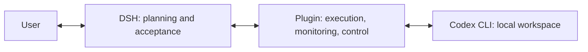

# dsh-codex-runner

**Bring Codex into your DSH workflow**

Start tasks · Run in the background · Check progress · Send instructions · Read complete answers

[Install](#download-and-install) · [Get started](#get-started) · [Settings](#change-settings) · [Documentation](docs/README.en.md) · [中文](README.md)

[](package.json)
[](LICENSE)
[](#download-and-install)
[](package.json)
[](package.json)
[](#model-selection-beta)

**dsh-codex-runner** is a Windows DSH plugin for delegating project tasks to the local Codex CLI and managing their execution and results. Codex uses your local workspace and existing login; DSH handles planning, review, and follow-up work

## What you can do

| Your goal | Plugin capability |
| --- | --- |
| Delegate project work to Codex | Start tasks in the current workspace and receive complete final answers |
| Run long tasks | Execute in the background, then query or cancel by run ID after a DSH restart |
| Add instructions during execution | Steer or interrupt the current turn, or queue a follow-up |
| Inspect progress and history | Query execution status, account quota, and associated workspace sessions |
| Manage permissions and configuration | Use native settings, a full configuration editor, and an editable field registry |
| Enable optional enhancements | Choose quota pauses, recovery, and periodic status reports with explicit token-cost descriptions |

## Download and install

Requires **Windows, Node 20 or newer, DSH, and an installed, authenticated Codex CLI**. The declared DSH range is `>=0.2.0-rc.2 <0.3.0`. The plugin does not bundle Codex CLI or handle account login for you

| Distribution | Location | Version |
| --- | --- | --- |
| npm package | [dsh-codex-runner](https://www.npmjs.com/package/dsh-codex-runner/v/0.5.0-rc.2) | `0.5.0-rc.2`, under the `next` prerelease tag |
| `.tgz` plugin archive | [Download archive](https://github.com/halftin/dsh-codex-runner/releases/download/v0.5.0-rc.2/dsh-codex-runner-0.5.0-rc.2.tgz) · [Release notes](https://github.com/halftin/dsh-codex-runner/releases/tag/v0.5.0-rc.2) | `v0.5.0-rc.2` |
| GitHub repository | [halftin/dsh-codex-runner](https://github.com/halftin/dsh-codex-runner) | Tag `v0.5.0-rc.2` or development branch `main` |

**DSH interface:** Open **Plugins → Add plugin**, enter the following spec, and enable the plugin or restart DSH when prompted

```text
dsh-codex-runner@0.5.0-rc.2
```

**CLI:** Replace `<profile>` with the DSH profile you actually use

```text
dsh plugin --profile <profile> add dsh-codex-runner@0.5.0-rc.2
```

If you already have an archive, install the local file instead:

```text
dsh plugin --profile <profile> add ./dsh-codex-runner-0.5.0-rc.2.tgz
```

You can also enter `github:halftin/dsh-codex-runner#v0.5.0-rc.2` to install this version from source. `main` changes during development, while `next` follows newer prereleases; the commands above pin `0.5.0-rc.2`. Install through DSH without a separate `npm install` step. See [Installation and environment](docs/installation.en.md) for executable paths, environment checks, troubleshooting, and uninstall

## Get started

1. Run `codex login` in a terminal to authenticate Codex
2. Choose a project workspace in DSH, run `codex_doctor()` to check connectivity, then use `codex_models()` to inspect available models
3. Give DSH the task, scope, and acceptance requirements, with an explicit model and reasoning effort when the task starts

For example, ask DSH:

> Use Codex to fix this issue in the current project. Check the available models and reasoning efforts first, then carry out the task, run relevant checks, and review the result

For direct tool calls, replace the placeholders with actual values:

```text
codex_run(prompt_file="task.md", label="task", model="<available model ID>", effort="<supported effort>", detach=true)
codex_status(run_id="<returned run ID>")
codex_say(run_id="<run ID>", action="steer", message="Additional instructions")
codex_cancel(run_id="<run ID>")
```

`task.md` is a task file you have written in the current workspace. Each execution returns a unique run ID for subsequent queries, instructions, or cancellation. Automatic completion is off by default, so choose model and effort explicitly from the first run

See [Tools and task operations](docs/tools.en.md) for all tools, conversation reading, continuation, and status semantics

## Change settings

Open the plugin's detail page in DSH, change the controls, then click **Save** in the fixed bottom bar

| Settings | Purpose |
| --- | --- |
| Model and reasoning effort | Set fallback tiers available when automatic completion is enabled |
| Sandbox and approval | Control Codex access permissions and approval behavior |
| Low-quota pause and recovery | Optionally send pause/resume messages, with additional model-token usage |
| Periodic Codex status queries | Ask DSH to check and report progress, consuming DSH model tokens |
| Advanced settings | Manage concurrency, history retention, debug recording, and local CLI paths |

**Edit full configuration and registry** at the end of Advanced settings opens Table, Registry JSON, and Configuration JSON tabs. They share an editing draft; Save writes the corresponding configuration. Refresh registry independently updates the reference cache

Controls and configuration JSON share the current DSH profile. Saved values apply to subsequent tasks; an already launched Codex task retains its launch parameters. The interface follows DSH's Chinese/English language selection

See [Configuration and registry](docs/configuration.en.md) for defaults, precedence, save behavior, and token costs

### Model selection beta

Automatic model and reasoning-effort completion is disabled by default. When enabled, code applies selection rules using call parameters, task types, and declared evidence. Its accuracy across task complexities has not been demonstrated, and it does not promise fixed token or quota savings

## How it works



The plugin runs tasks through Codex App Server or a compatibility CLI driver. Process management, status queries, and local records run in code without separate model calls. Codex task execution, DSH review, and notification handling still use the relevant models

An execution ending does not establish that the user's goal is complete; DSH reviews the outcome. Prompts are sent as submitted by DSH. Records stay in the workspace, credentials are not copied, and project changes are not automatically rolled back

See [Runtime, quota, and troubleshooting](docs/runtime.en.md) for recovery, notifications, retention, and diagnostics

## Documentation and feedback

[User documentation](docs/README.en.md) · [Report an issue](https://github.com/halftin/dsh-codex-runner/issues) · [Source](https://github.com/halftin/dsh-codex-runner)

Current version: `0.5.0-rc.2`. Isolated acceptance used a fake CLI on Windows / Node 24 / DSH 0.2.1-rc.3 Web profile. See [Supported environment](docs/installation.en.md#supported-environment) for coverage limits across machines, Desktop installers, and other versions

## License

[MIT](LICENSE)
