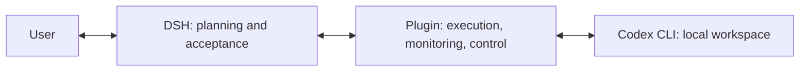

# dsh-codex-runner

**Bring Codex into your DSH workflow**

Start tasks · Run in the background · Check progress · Send instructions · Read complete answers

[Install](#download-and-install) · [Get started](#get-started) · [Settings](#change-settings) · [Documentation](docs/README.en.md) · [中文](README.md)

[](package.json)
[](LICENSE)
[](https://github.com/halftin/dsh-codex-runner/releases/download/v0.5.3-beta/dsh-codex-runner-0.5.3-beta.tgz)
[](https://awesome-dsh-plugin.com/p/halftin/dsh-codex-runner/)
[](#download-and-install)
[](package.json)
[](package.json)
[](#model-selection-beta)

**dsh-codex-runner** is a Windows DSH plugin for delegating project tasks to the local Codex CLI and managing their execution and results. Codex uses your local workspace and existing login; DSH handles planning, review, and follow-up work

## What you can do

| Your goal | Plugin capability |
| --- | --- |
| Delegate project work to Codex | Start tasks in the current workspace and receive complete final answers |
| Run long tasks | Execute in the background, then query or cancel by run ID after a DSH restart |
| Add instructions during execution | Steer or interrupt the current turn, or queue a follow-up |
| Inspect progress and history | Query execution status, account quota, and associated workspace sessions |
| Watch output during execution | Both backends show prose and expandable operations in the chat flow without model calls for display |
| Let DSH supervise | Read progress in batches, answer original requests, and adjust the same task within existing authorization |
| Manage permissions and configuration | Use native settings, a full configuration editor, and an editable field registry |
| Enable optional enhancements | Choose quota pauses, recovery, and periodic status reports with explicit token-cost descriptions |

Live display and supervision are independently enabled by default. Both App Server and exec show completed messages and operations as separate chat records and catch up after reconnection. Continuous output queries stop once a task ends and its output is drained. Display alone makes no model calls; supervision consumes DSH model tokens and automatically detaches new runs when the host supports it. See [Runtime](docs/runtime.en.md).

## Download and install

Requires **Windows, DSH, and an installed, authenticated Codex CLI**. Node `22.23.4` is the minimum; `22.23.4` and `24.22.2` have been tested. The declared DSH range is `>=0.2.1-rc.3 <0.3.0`. The plugin does not bundle Codex CLI or handle account login. See [Supported environment](docs/installation.en.md#supported-environment).

Version **`0.5.3-beta`** is a prerelease. The commands below pin this version; npm `next` tracks newer prereleases.

Listed in the community catalog used by DSH Market. Open the [plugin details](https://awesome-dsh-plugin.com/p/halftin/dsh-codex-runner/) or search for `dsh-codex-runner` in DSH Market. The catalog entry provides the `0.5.3-beta` release archive.

| Distribution | Location | Availability |
| --- | --- | --- |
| npm package | [dsh-codex-runner](https://www.npmjs.com/package/dsh-codex-runner) | `0.5.3-beta` (`next` channel) |
| `.tgz` plugin archive | [Download 0.5.3-beta](https://github.com/halftin/dsh-codex-runner/releases/download/v0.5.3-beta/dsh-codex-runner-0.5.3-beta.tgz) | Prebuilt plugin archive |
| GitHub repository | [halftin/dsh-codex-runner](https://github.com/halftin/dsh-codex-runner) | `main` is the development branch |

**DSH interface:** Open **Plugins → Add plugin**, enter the following spec, and enable the plugin or restart DSH when prompted

```text
dsh-codex-runner@0.5.3-beta
```

**CLI:** Replace `<profile>` with the DSH profile you actually use

```text
dsh plugin --profile <profile> add dsh-codex-runner@0.5.3-beta
```

If you already have an archive, install the local file instead:

```text
dsh plugin --profile <profile> add ./dsh-codex-runner-0.5.3-beta.tgz
```

You can also enter `github:halftin/dsh-codex-runner#v0.5.3-beta` to install this version from source. `main` changes during development, while `next` follows newer prereleases; the commands above pin `0.5.3-beta`. Install through DSH without a separate `npm install` step. See [Installation and environment](docs/installation.en.md) for executable paths, environment checks, troubleshooting, and uninstall

## Get started

1. Run `codex login` in a terminal to authenticate Codex
2. Choose a project workspace in DSH, run `codex_doctor()` to check connectivity, then use `codex_models()` to inspect available models
3. Give DSH the task, scope, and acceptance requirements, using the configured default model and effort; supply them explicitly only after enabling DSH model autonomy

For example, ask DSH:

> Use Codex to fix this issue in the current project. Check the available models and reasoning efforts first, then carry out the task, run relevant checks, and review the result

For direct tool calls, replace the placeholders with actual values:

```text
codex_run(prompt_file="task.md", label="task", detach=true)
codex_status(run_id="<returned run ID>")
codex_say(run_id="<run ID>", action="steer", message="Additional instructions")
codex_cancel(run_id="<run ID>")
```

`task.md` is a task file you have written in the current workspace. Each execution returns a unique run ID for subsequent queries, instructions, or cancellation. "Let DSH choose model and reasoning effort" is off by default, so runs use the configured default model and effort; enable it to have DSH choose and pass `model` and `effort` per task. Omit both parameters while it is off

See [Tools and task operations](docs/tools.en.md) for all tools, conversation reading, continuation, and status semantics

## Change settings

Open the plugin's detail page in DSH, change the controls, then click **Save** in the fixed bottom bar

| Settings | Purpose |
| --- | --- |
| Model and reasoning effort | Defaults used when DSH autonomy is off; DSH picks per task when enabled |
| Live display and supervision | Control chat record display and active DSH supervision separately; supervision consumes model tokens |
| Sandbox and approval | Control Codex access permissions and approval behavior |
| Low-quota pause and recovery | Optionally send pause/resume messages, with additional model-token usage |
| Periodic Codex status queries | Ask DSH to check and report progress, consuming DSH model tokens |
| Advanced settings | Manage concurrency, history retention, debug recording, and local CLI paths |

**Edit full configuration and registry** at the end of Advanced settings opens Table, Registry JSON, and Configuration JSON tabs. They share an editing draft; Save writes the corresponding configuration. Refresh registry independently updates the reference cache

Controls and configuration JSON share the current DSH profile. Saved execution parameters apply to subsequent tasks; an already launched Codex task retains its launch parameters. Live display switches take effect immediately after saving. The interface follows DSH's Chinese/English language selection.

See [Configuration and registry](docs/configuration.en.md) for defaults, precedence, save behavior, and token costs

### Model selection beta

"Let DSH choose model and reasoning effort" is off by default: new tasks use the configured default model and default reasoning effort, and DSH neither selects nor may pass model/effort. When enabled, DSH chooses explicitly from the task. The preset selection policy is off by default (no task-kind or evidence rules); only audit or enforce activates it. The policy is subordinate to the main switch, and its controls are hidden while the policy is off. Quota, cost and waiting time must not cause unilateral downgrades. Automatic quota recovery retains the original recorded model and effort and checks current model availability, policy, and permissions; changing defaults does not silently change the resumed task's selection. Preset rules remain beta, without proven complexity-classification accuracy or quota savings

## How it works



The plugin runs tasks through Codex App Server or a compatibility CLI driver. Process management, status queries, and local records run in code without separate model calls. Codex task execution, DSH review, and notification handling still use the relevant models

An execution ending does not establish that the user's goal is complete; DSH reviews the outcome. Prompts are sent as submitted by DSH. Records stay in the workspace, credentials are not copied, and project changes are not automatically rolled back

See [Runtime, quota, and troubleshooting](docs/runtime.en.md) for recovery, notifications, retention, and diagnostics

## Documentation and feedback

[User documentation](docs/README.en.md) · [Report an issue](https://github.com/halftin/dsh-codex-runner/issues) · [Source](https://github.com/halftin/dsh-codex-runner)

Version: `0.5.3-beta`. Offline regression passed 43/43 on Windows with both Node `22.23.4` and `24.22.2`. On the minimum supported version, real DSH `0.2.1-rc.3` Web host and Chrome smoke tests passed for both backends. Acceptance used deterministic model/CLI fixtures, with no paid model calls; it does not establish Electron desktop coverage. See [Supported environment](docs/installation.en.md#supported-environment).

## License

[MIT](LICENSE)
