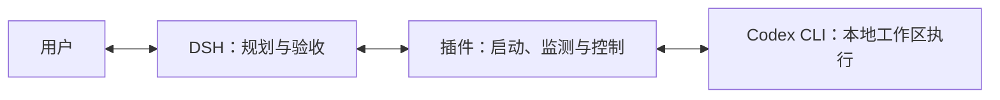

# dsh-codex-runner


**在 DSH 中，把 Codex 接入你的工作流**

启动任务 · 后台执行 · 查询进度 · 追加指令 · 读取完整答复

[下载与安装](#下载与安装) · [开始使用](#开始使用) · [修改设置](#修改设置) · [使用文档](docs/README.md) · [English](README.en.md)

[](https://github.com/halftin/dsh-codex-runner/releases/download/v0.5.3-beta/dsh-codex-runner-0.5.3-beta.tgz)
[](https://awesome-dsh-plugin.com/p/halftin/dsh-codex-runner/)
[](#下载与安装)
[](package.json)
[](package.json)
[](#模型选档-beta)

**dsh-codex-runner** 是面向 Windows 的 DSH 插件，让 DSH 调用本机 Codex CLI 完成项目任务，并管理执行过程与结果。Codex 使用你的本地工作区和已有登录，DSH 负责规划、复查和后续推进

## 可以做什么


| 你想做的事 | 插件提供的能力 |
| --- | --- |
| 把项目任务交给 Codex | 在当前工作区启动任务，返回完整最终答复 |
| 运行耗时任务 | 支持后台执行，DSH 重启后仍可按运行 ID 查询或取消 |
| 执行中补充要求 | 向当前轮发送指令、中断当前轮，或排队追加下一轮 |
| 查看进展与历史 | 查询执行状态、账号额度和当前工作区的关联会话 |
| 在执行期间查看输出 | 两种后端在主聊天区显示正文与可展开操作，单纯显示不调用模型 |
| 让 DSH 主动监督 | 分批读取进度、处理原请求问答，并按已有授权调整同一任务 |
| 管理权限与配置 | 原生设置页、完整配置编辑器和可编辑的字段注册表 |
| 按需启用增强功能 | 低额度暂停、额度恢复续跑和定时状态报告，明确说明额外 token 开销 |

实时显示与主动监督默认均开启，可分别关闭。App Server 与 exec 两种后端将已完成的消息和操作显示为独立聊天记录，支持断线后补读；任务结束并读完输出后停止持续查询。单纯显示不调用模型，主动监督消耗 DSH 模型 token，并在宿主可用时让新任务自动后台运行。详见[运行说明](docs/runtime.md)。

## 下载与安装

需要 **Windows、DSH，以及已安装并登录的 Codex CLI**。Node 最低版本为 `22.23.4`，已验证 `22.23.4` 和 `24.22.2`；声明的 DSH 范围为 `>=0.2.1-rc.3 <0.3.0`。插件不包含 Codex CLI，也不代替 Codex 账号登录。详见[支持范围](docs/installation.md#支持范围)。

当前版本为 **`0.5.3-beta` 预发行版**。以下命令固定安装此版本；npm 的 `next` 标签随新的预发行版更新。

已收录至 DSH Market 使用的社区目录。可打开[插件详情页](https://awesome-dsh-plugin.com/p/halftin/dsh-codex-runner/)，或在 DSH Market 搜索 `dsh-codex-runner`；当前目录条目提供 `0.5.3-beta` 发行包。

| 获取方式 | 入口 | 说明 |
| --- | --- | --- |
| npm 包 | [dsh-codex-runner](https://www.npmjs.com/package/dsh-codex-runner) | `0.5.3-beta`（`next` 渠道） |
| `.tgz` 插件包 | [下载 0.5.3-beta](https://github.com/halftin/dsh-codex-runner/releases/download/v0.5.3-beta/dsh-codex-runner-0.5.3-beta.tgz) | 预构建插件包 |
| GitHub 仓库 | [halftin/dsh-codex-runner](https://github.com/halftin/dsh-codex-runner) | `main` 为开发分支 |

**通过 DSH 界面安装：** 打开“插件 → 添加插件”，填写以下地址，安装后按提示启用插件或重启 DSH

```text
dsh-codex-runner@0.5.3-beta
```

**通过 CLI 安装：** 将 `<profile>` 替换为实际使用的 DSH profile

```text
dsh plugin --profile <profile> add dsh-codex-runner@0.5.3-beta
```

已有 `.tgz` 文件时，也可以直接安装本地包：

```text
dsh plugin --profile <profile> add ./dsh-codex-runner-0.5.3-beta.tgz
```

也可填写 `github:halftin/dsh-codex-runner#v0.5.3-beta` 安装此版本的源码。`main` 会随开发更新，`next` 会随新的预发布版本更新；上述命令固定安装 `0.5.3-beta`。通过 DSH 安装插件即可，无需另行执行 `npm install`。环境检查、可执行文件路径、安装排查和卸载方法见[安装文档](docs/installation.md)

## 开始使用

1. 在终端执行 `codex login`，完成 Codex 登录
2. 在 DSH 中选择项目工作区，运行 `codex_doctor()` 检查连接，再用 `codex_models()` 查看可用模型
3. 将任务交给 DSH，说明目标、范围和验收要求；默认使用设置中的模型和思考强度；开启自主选档后再显式提供

例如，可以向 DSH 提出：

> 请使用 Codex 修复当前项目中的这个问题，先确认可用模型和思考强度，再执行任务、运行相关检查并复查结果

需要直接调用工具时，可参考以下示例，将占位符替换为实际值：

```text
codex_run(prompt_file="task.md", label="task", detach=true)
codex_status(run_id="<返回的运行 ID>")
codex_say(run_id="<运行 ID>", action="steer", message="补充要求")
codex_cancel(run_id="<运行 ID>")
```

`task.md` 是当前工作区中写好的任务文件。每次执行会返回唯一运行 ID，后续可准确查询、追加指令或取消。「DSH 自主选模型与推理强度」默认关闭，运行直接使用设置里的默认模型与默认推理强度；开启后由 DSH 按任务明确选择并传入 `model` 与 `effort`；关闭时必须省略这两个参数

完整工具列表、读取会话、任务续跑和状态含义见[工具与任务操作](docs/tools.md)

## 修改设置

打开 DSH 中该插件的详情页，修改设置后点击底部固定的 **保存** 按钮

| 设置内容 | 用途 |
| --- | --- |
| 模型与思考强度 | 默认模型与推理强度；开启自主选档后由 DSH 按任务选择 |
| 实时显示与主动监督 | 分别控制聊天记录显示和 DSH 主动处理进展；后者消耗模型 token |
| 沙箱与审批 | 控制 Codex 任务的访问权限和审批方式 |
| 低额度暂停与自动恢复 | 按需向 Codex 发送暂停或续跑消息，会产生额外模型 token 消耗 |
| 定时查询 Codex 状态 | 让 DSH 定期查询并报告进展，会消耗 DSH 模型 token |
| 高级设置 | 管理并发、历史保留、调试记录和本机 CLI 路径 |

高级设置末尾的 **编辑完整配置与注册表** 提供表格、注册表 JSON、配置 JSON 三个页签。它们共用编辑草稿，点击保存后才写入对应配置；刷新注册表会独立更新参考缓存

设置页与配置 JSON 共用当前 DSH profile。保存后的执行参数用于后续任务，已经启动的 Codex 任务保留启动参数；实时显示开关保存后立即生效。插件界面跟随 DSH 的中英文语言设置。

配置优先级、默认值、编辑器保存规则及 token 开销说明见[配置与注册表](docs/configuration.md)

### 模型选档 Beta

「DSH 自主选模型与推理强度」默认关闭：新任务使用设置里的默认模型与默认推理强度，DSH 不参与选档，也不能传 model/effort。开启后由 DSH 根据任务目标事前明确选择；预设选档策略默认关闭，此时不使用任务类型或证据规则，只有选择仅审计或强制执行才启用策略。策略从属于主开关，策略关闭时其下控件不显示。额度将满、成本或等待时间不能成为擅自降档的理由。自动额度恢复沿用原任务记录的模型和推理强度，并重新检查当前可用模型、策略和权限；默认档位变化不会让续跑静默换档。预设规则仍为 Beta，不承诺复杂度判断准确率或额度节省

## 运行原理




插件通过 Codex App Server 或兼容 CLI 驱动执行任务。启动、进程监测、状态查询和本地记录由代码处理，不为这些机械操作单独调用模型；Codex 执行任务、DSH 复查结果及处理通知仍会产生相应模型用量

一次执行结束不等于用户目标已经完成，结果仍由 DSH 复查。提示词按 DSH 提交内容发送；执行记录保存在当前工作区，插件不复制登录凭据，也不自动回滚项目改动

额度恢复、通知、数据保留和故障排查见[运行说明](docs/runtime.md)

## 文档与反馈

[使用文档](docs/README.md) · [问题反馈](https://github.com/halftin/dsh-codex-runner/issues) · [源码](https://github.com/halftin/dsh-codex-runner)

当前版本为 `0.5.3-beta`。Windows 下 Node `22.23.4` 与 `24.22.2` 的离线回归均为 43/43 通过；最低支持版本下，真实 DSH `0.2.1-rc.3` Web 宿主与 Chrome 已通过两种后端的冒烟验收。验收使用确定性模型/CLI 夹具，未调用付费模型，也不代表 Electron 桌面端验收。详见[支持范围](docs/installation.md#支持范围)。

## 开源许可

[MIT](LICENSE)
